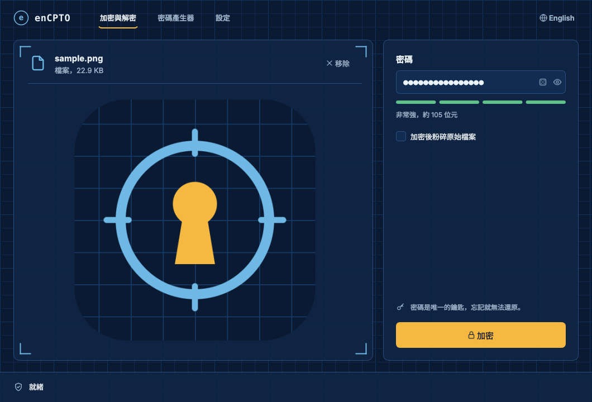
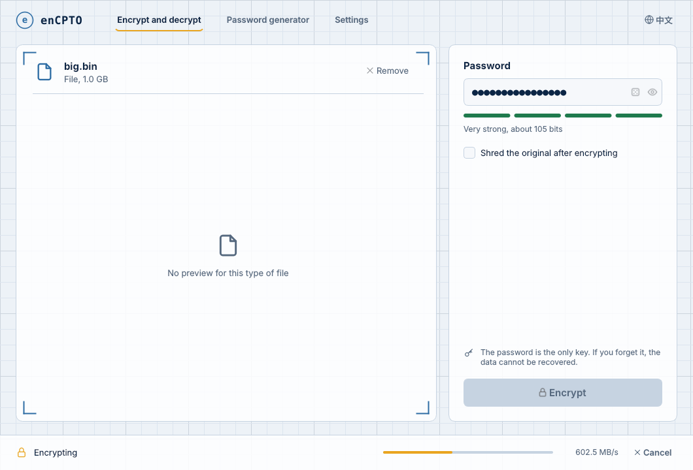
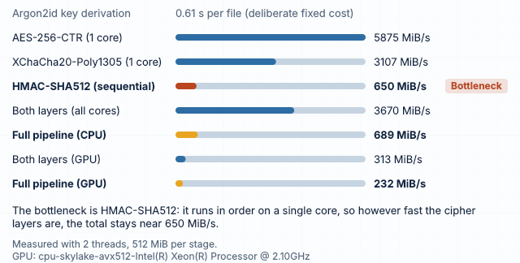

# enCPTO

[](https://github.com/nil-coder-sudo/enCPTO/actions/workflows/ci.yml)
[](https://github.com/nil-coder-sudo/enCPTO/releases/latest)
[](LICENSE)

**English** · [繁體中文](README.zh-TW.md)

Offline file and folder encryption. enCPTO cascades two independent ciphers —
**AES-256-CTR** and **XChaCha20-Poly1305** — under keys derived with
**Argon2id + HKDF-SHA512**, and seals every container with **HMAC-SHA512**.
No cloud, no accounts, no telemetry: one password, and it never leaves your machine.

Version 8 is a native C++ rewrite of the v7 Python tool. Files are **byte-for-byte compatible**
with v7.0 in both directions; it is just faster, smaller and needs nothing installed.

<p align="center">
  
  
</p>

## Download

Get the latest build from **[Releases](https://github.com/nil-coder-sudo/enCPTO/releases/latest)**:

| Platform | File | Notes |
|---|---|---|
| Windows 10/11 x64 | `enCPTO-…-windows-x64.zip` | Portable: unzip and run `enCPTO.exe` |
| macOS 12+ (Apple Silicon) | `enCPTO-…-macos-arm64.dmg` | Not notarised: right-click → **Open** the first time |
| Linux x86-64 | `enCPTO-…-linux-x86_64.AppImage` | `chmod +x` and run; CLI also as `.tar.gz` |

Every package includes the `encpto-cli` command-line tool. `SHA256SUMS.txt` is published alongside.

## Features

- **Two ciphers from different families.** Layer 1 AES-256-CTR, layer 2 XChaCha20-Poly1305, each with its own HKDF sub-key. Reading the data means breaking both.
- **Memory-hard key derivation.** Argon2id, t=4, 256 MiB, p=4, 32-byte salt. The parameters live in each file's header, so they can be raised later without breaking old files.
- **Verified before anything is written.** Each 4 MiB chunk is bound to the header, its index and a final-chunk flag; HMAC-SHA512 covers the whole file and is checked before a single byte of plaintext reaches the disk. A wrong password is rejected in under a second.
- **Nothing leaks.** The original file name and whether it was a file or a folder are encrypted and padded to a fixed size.
- **Folders.** Packed into a ZIP in memory (parallel compression, media files stored as-is, empty folders kept) and encrypted; the plaintext archive never touches the disk.
- **Shredder.** Optional 3-pass overwrite (0x00 → 0xFF → random), rename and delete of the source after encryption.
- **Desktop app.** Drag and drop, previews, live progress with speed and cancel, password generator, six themes (Blueprint, Drafting paper, System, Automatic, Army green, Terminal green), custom background, 繁體中文 / English.

## Performance

v8 spreads the cipher work over every CPU core and overlaps it with the (inherently sequential) HMAC and with disk I/O.
Measured on the same 2-vCPU cloud VM, same files, same password; machines with more cores gain more.

| Task | v7.0 (Python) | v8.0 (C++) | |
|---|---:|---:|---:|
| Encrypt 1 GiB file | 4.6 s | 2.4 s | **1.9×** |
| Decrypt 1 GiB file | 5.0 s | 3.2 s | **1.6×** |
| Encrypt 386 MB folder (170 files) | 7.5 s | 3.0 s | **2.5×** |
| Decrypt 386 MB folder | 3.0 s | 2.0 s | **1.5×** |

Every operation includes a fixed ~0.5 s for Argon2id — that is deliberate, it is what makes password guessing expensive.
CI prints a fresh benchmark for every platform in the *Benchmark* step.

### Measure your own machine

**Settings → Experimental → Run benchmark** (or `encpto-cli bench`) times every stage on your computer
and names the one that limits end-to-end speed:

<p align="center"></p>
<p align="center"><sub>2-vCPU cloud VM. The “GPU” rows are PoCL running OpenCL on those same two CPU cores, not a graphics card.</sub></p>

On most machines the bottleneck is **HMAC-SHA512**: the V7 format authenticates the whole file with one
HMAC, which has to be computed from start to end on a single core. The cipher layers run several times
faster than that, so neither more cores nor a GPU can push a single file past the HMAC speed.

## Experimental: GPU acceleration

**Settings → Experimental → Use GPU acceleration** (or `--gpu` on the command line) runs both cipher
layers on an OpenCL device — NVIDIA, AMD, Intel or Apple. One kernel produces the AES-256-CTR and ChaCha20
keystreams together, so each 4 MiB chunk crosses the bus once in each direction; Poly1305 and HMAC stay on
the CPU. Encrypted files are **byte-identical** to the CPU path (checked in CI on every push).

Things to know before turning it on:

- **It rarely makes things faster.** See the benchmark above: the cipher layers are not the bottleneck.
  It is here for people who want to see for themselves.
- **Keys and data pass through graphics memory**, which cannot be locked like system memory and is not
  guaranteed to be cleared by the driver (cf. [LeftoverLocals, CVE-2023-4969](https://nvd.nist.gov/vuln/detail/CVE-2023-4969)).
  enCPTO zero-fills every device buffer after use, but cannot control what the driver does.
- The GPU uses table-based AES, which is not constant-time; on a shared GPU another process could in
  principle measure timing. The CPU path uses AES-NI and has no such issue.
- OpenCL is loaded at run time. Without a driver the switch is simply greyed out.

`encpto-cli gpu` lists the devices; `--device N` picks one.

## Command line

```bash
encpto-cli encrypt report.pdf                 # → report.pdf.dat (asks for the password twice)
encpto-cli encrypt "My Folder" -o backup.dat --shred
encpto-cli decrypt backup.dat -o restored/     # restores "My Folder" under its original name
encpto-cli info backup.dat
encpto-cli genpass --length 32 --no-ambiguous
encpto-cli bench --gpu                         # time every stage, find the bottleneck
```

`--password-stdin` reads the password from the first line of standard input for scripting.
Exit codes: `0` success, `3` wrong password, `4` damaged or modified file, `130` cancelled.

## Building from source

Requirements: CMake ≥ 3.21, a C++20 compiler, OpenSSL 3, libsodium, Qt ≥ 6.4 (Widgets, Svg).
Argon2, libdeflate, miniz and the OpenCL headers are fetched automatically at a pinned version.

```bash
# Debian / Ubuntu
sudo apt install cmake ninja-build pkg-config libssl-dev libsodium-dev qt6-base-dev qt6-svg-dev
# macOS
brew install cmake ninja pkg-config openssl@3 libsodium qt

cmake -S . -B build -G Ninja -DCMAKE_BUILD_TYPE=Release
cmake --build build
ctest --test-dir build --output-on-failure
./build/src/app/encpto            # or build/src/app/enCPTO.app on macOS
```

On Windows, install Qt 6 and build with the vcpkg toolchain (OpenSSL and libsodium come from `vcpkg.json`):

```powershell
cmake -S . -B build -A x64 -DCMAKE_TOOLCHAIN_FILE=$env:VCPKG_ROOT/scripts/buildsystems/vcpkg.cmake `
      -DVCPKG_TARGET_TRIPLET=x64-windows-static-md -DCMAKE_PREFIX_PATH=C:/Qt/6.8.3/msvc2022_64
cmake --build build --config Release
```

Options: `-DENCPTO_BUILD_GUI=OFF` (engine + CLI only), `-DENCPTO_BUILD_TESTS=OFF`.

## Project layout

```
src/core/       encryption engine (no Qt): format, crypto, pipeline, archive, shredder
src/cli/        encpto-cli
src/app/        Qt 6 desktop app
tests/          unit tests, fixtures made by the Python tool, Python reference implementation
legacy/         the v7.0 Python app (needed only for V1–V6 files)
docs/           container format specification, screenshots
.github/        CI (Linux, macOS, Windows + C++⇄Python compatibility) and release packaging
index.html      project website (GitHub Pages)
```

## Compatibility

- **V7 containers** (made by v7.0 or v8): fully supported, both directions — verified in CI against
  files produced by the original Python tool and by an independent Python reference implementation.
- **V1–V6 containers** (v6.x and older): not read by v8. Decrypt them once with
  [`legacy/enCPTO-v7.py`](legacy/), then re-encrypt with v8.
- Settings in `~/.encpto/ui_prefs.cfg` carry over.

The byte-level format is documented in [docs/FORMAT.md](docs/FORMAT.md).

## Security notes

- The password is the only key. There is no recovery: if you forget it, the data is gone. Use a password manager.
- The cryptography comes from widely used libraries (OpenSSL, libsodium, the Argon2 reference implementation),
  but enCPTO itself has **not** had a formal third-party audit. For regulated or high-stakes use, prefer audited tools.
- Keys are held in locked, guard-paged memory (`sodium_malloc`) and wiped after use; plaintext buffers are wiped too.
- Shredding cannot guarantee that data is unrecoverable on SSDs, copy-on-write or journaling file systems, or with snapshots.
- Please report vulnerabilities privately — see [SECURITY.md](SECURITY.md).

## Contributing

Issues and pull requests are welcome, especially cross-platform testing, translations and security review.
Run `ctest` and `python tests/compat/run_compat.py build/src/cli/encpto-cli` before submitting.

## License

[MIT](LICENSE). Bundled at build time: Argon2 (CC0/Apache-2.0), libdeflate (MIT), miniz (MIT); linked: OpenSSL (Apache-2.0), libsodium (ISC), Qt (LGPLv3).
