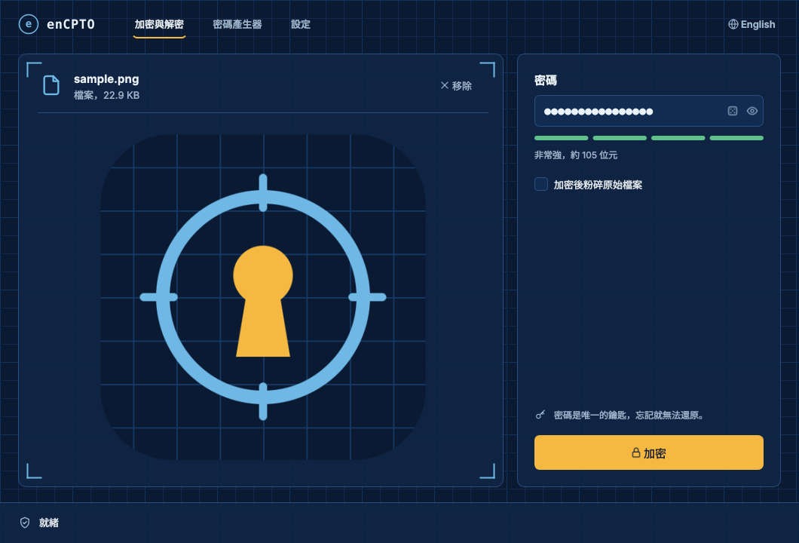
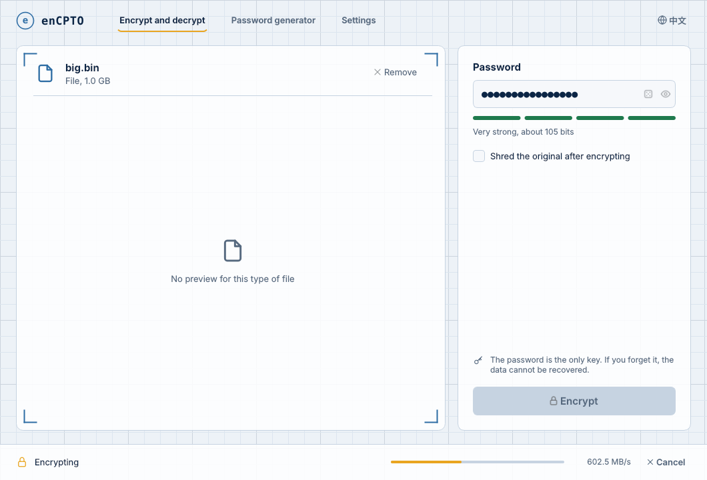

# enCPTO

[English](README.md) · **繁體中文**

離線的檔案與資料夾加密工具。enCPTO 以兩種不同家族的加密演算法串接——
**AES-256-CTR** 與 **XChaCha20-Poly1305**——金鑰由 **Argon2id + HKDF-SHA512** 推導，
整個加密檔再以 **HMAC-SHA512** 封裝驗證。不用雲端、不用帳號、沒有遙測：只有一組密碼，而且永遠不會離開你的電腦。

v8 是 v7 Python 版的 C++ 原生改寫。加密檔與 v7.0 **逐位元組相容**（雙向皆可），只是更快、更小，也不需要安裝任何東西。

<p align="center">
  
  
</p>

## 下載

到 **[Releases](https://github.com/nil-coder-sudo/enCPTO/releases/latest)** 下載最新版：

| 平台 | 檔案 | 說明 |
|---|---|---|
| Windows 10/11 x64 | `enCPTO-…-windows-x64.zip` | 免安裝：解壓縮後執行 `enCPTO.exe` |
| macOS 12 以上（Apple Silicon） | `enCPTO-…-macos-arm64.dmg` | 尚未公證：第一次請按右鍵 →「打開」 |
| Linux x86-64 | `enCPTO-…-linux-x86_64.AppImage` | `chmod +x` 後直接執行；命令列工具另附 `.tar.gz` |

每個套件都包含命令列工具 `encpto-cli`，並附上 `SHA256SUMS.txt` 供驗證。

## 功能

- **雙層加密**：第一層 AES-256-CTR、第二層 XChaCha20-Poly1305，各自使用獨立的 HKDF 子金鑰；要讀取資料必須兩者都被攻破。
- **抗暴力破解的金鑰推導**：Argon2id（t=4、256 MiB、p=4、32 位元組 salt）。參數寫在每個檔案的檔頭，日後可提高強度而不影響舊檔。
- **先驗證、後寫出**：每個 4 MiB 區塊都綁定檔頭、序號與「最後區塊」旗標；HMAC-SHA512 覆蓋整個檔案，驗證通過前不會寫出任何明文。密碼錯誤在一秒內就會被拒絕。
- **不洩漏資訊**：原始檔名、是檔案還是資料夾，都會加密並補齊到固定長度。
- **資料夾**：在記憶體中打包成 ZIP（多執行緒壓縮、影音圖片直接儲存、保留空資料夾）後加密，未加密的壓縮檔不會寫到磁碟。
- **安全粉碎**：加密後可選擇以三次覆寫（0x00 → 0xFF → 亂數）、改名並刪除原始檔。
- **桌面程式**：拖放、預覽、即時進度（含速度與取消）、密碼產生器、六種主題（藍圖、製圖紙、跟隨系統、依時間自動、軍綠、終端機綠）、自訂背景、繁體中文／English。

## 效能

v8 把加解密分散到所有 CPU 核心，並讓（必須依序計算的）HMAC 與磁碟讀寫同時進行。
以下在同一台 2 vCPU 雲端主機、相同檔案與密碼下測得；核心越多的電腦提升越明顯。

| 項目 | v7.0（Python） | v8.0（C++） | |
|---|---:|---:|---:|
| 加密 1 GiB 檔案 | 4.6 秒 | 2.4 秒 | **1.9 倍** |
| 解密 1 GiB 檔案 | 5.0 秒 | 3.2 秒 | **1.6 倍** |
| 加密 386 MB 資料夾（170 個檔案） | 7.5 秒 | 3.0 秒 | **2.5 倍** |
| 解密 386 MB 資料夾 | 3.0 秒 | 2.0 秒 | **1.5 倍** |

每次操作都包含約 0.5 秒的 Argon2id 計算——這是刻意的，正是它讓猜密碼變得昂貴。
CI 的 *Benchmark* 步驟會在每個平台印出最新數據。

## 命令列

```bash
encpto-cli encrypt report.pdf                 # → report.pdf.dat（會要求輸入兩次密碼）
encpto-cli encrypt "My Folder" -o backup.dat --shred
encpto-cli decrypt backup.dat -o restored/     # 以原始名稱還原 "My Folder"
encpto-cli info backup.dat
encpto-cli genpass --length 32 --no-ambiguous
```

`--password-stdin` 會從標準輸入的第一行讀取密碼，方便寫腳本。
結束代碼：`0` 成功、`3` 密碼錯誤、`4` 檔案損毀或被修改、`130` 已取消。

## 從原始碼建置

需要：CMake 3.21 以上、支援 C++20 的編譯器、OpenSSL 3、libsodium、Qt 6.4 以上（Widgets、Svg）。
Argon2、libdeflate、miniz 會在設定階段自動下載固定版本。

```bash
# Debian / Ubuntu
sudo apt install cmake ninja-build pkg-config libssl-dev libsodium-dev qt6-base-dev qt6-svg-dev
# macOS
brew install cmake ninja pkg-config openssl@3 libsodium qt

cmake -S . -B build -G Ninja -DCMAKE_BUILD_TYPE=Release
cmake --build build
ctest --test-dir build --output-on-failure
```

Windows 請安裝 Qt 6，並使用 vcpkg 工具鏈（OpenSSL 與 libsodium 由 `vcpkg.json` 自動安裝），指令見英文版 README。

## 相容性

- **V7 加密檔**（v7.0 或 v8 建立）：完整支援、雙向相容。CI 會用原 Python 工具產生的檔案，以及獨立的 Python 參考實作來驗證。
- **V1–V6 加密檔**（v6.x 以前）：v8 不支援。請先用 [`legacy/enCPTO-v7.py`](legacy/) 解密一次，再用 v8 重新加密。
- `~/.encpto/ui_prefs.cfg` 中的設定會沿用。

位元組層級的格式說明請見 [docs/FORMAT.md](docs/FORMAT.md)。

## 安全注意事項

- 密碼是唯一的鑰匙，沒有任何找回機制。忘記密碼，資料就無法還原。建議使用密碼管理器。
- 加密演算法來自廣泛使用的函式庫（OpenSSL、libsodium、Argon2 參考實作），但 enCPTO 本身**尚未**經過正式的第三方安全稽核。法規要求或高風險用途，請優先選擇經過稽核的工具。
- 金鑰存放在鎖定且有防護頁的記憶體中（`sodium_malloc`），用完立即清除；明文緩衝區也會清除。
- 在 SSD、寫入時複製或日誌式檔案系統、或有快照的環境中，粉碎功能無法保證資料無法復原。
- 發現漏洞請私下回報，見 [SECURITY.md](SECURITY.md)。

## 授權

[MIT](LICENSE)。
